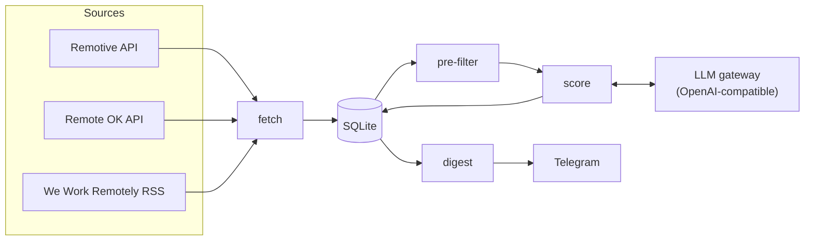

# Architecture

## Overview

Job Radar is a batch pipeline. One invocation of `python -m radar run` moves postings through
four stages and ends with at most one message to the user.



## Stages

| Stage | Module | Responsibility |
| --- | --- | --- |
| Fetch | `sources.py`, `fetch.py` | Call each adapter, normalise to one schema, insert unseen postings |
| Pre-filter | `filters.py` | Drop postings by title, seniority, location and description rules |
| Score | `score.py` | Ask the model for a 0-100 score and a one-sentence reason |
| Digest | `digest.py`, `telegram.py` | Select unsent postings above the threshold, render and deliver |

`pipeline.py` wires the stages together; `cli.py` exposes them as commands.

## Data model

A single table, `jobs`, keyed by `(source, external_id)`.

```text
new ──score──► scored ──deliver──► sent
```

- `new`: stored, not yet evaluated (or rejected by the pre-filter, which is recomputed on
  demand rather than persisted, so rule changes apply to old postings too).
- `scored`: has a `score` and `reason`; eligible for the next digest when `score >= min_score`.
- `sent`: included in a delivered digest; never delivered again.

`INSERT OR IGNORE` on the composite key makes ingestion idempotent: running the fetch stage
repeatedly cannot create duplicates.

## Design decisions

### Rules before the model

Model calls cost money and time. A whole-word, case-insensitive rule set on title and location
rejects roughly 95% of postings for free. The model then spends tokens only on plausible
candidates. The filter is intentionally permissive on unknown locations, because feeds are
unreliable (one provider labels almost everything "Anywhere"); the model reads the description
and makes the final call.

### An OpenAI-compatible gateway instead of a provider SDK

`score.py` speaks the OpenAI chat-completions protocol to a configurable `ROUTER_BASE_URL`.
Pointing it at a gateway such as 9router adds provider fallback, key management and usage
tracking without code changes, and replacing the gateway with any other compatible endpoint
is a configuration edit. The gateway can expose a named *combo* (for example `job-scorer`) that
maps to an ordered list of models, so a provider outage or a retired model does not stop the
pipeline.

The client tolerates both a JSON body and a server-sent-event stream, because some upstream
providers stream even when `stream` is false.

### An explicit output contract

- **stdout** carries only the digest text.
- **stderr** carries structured logs.
- **Empty stdout** means "nothing to report".
- A **non-zero exit code** means failure.

Any scheduler that forwards stdout (Hermes cron in `--no-agent` mode, `cron`, systemd timers,
Dokploy schedules) can run the tool without glue code, and quiet days produce no notification.

### Deliver at most once, even on failure

Rows are marked `sent` only after delivery succeeds. `--dry-run` and `--preview` never change
state, so they are safe to use against production data.

### Secrets stay out of logs

The Telegram Bot API URL contains the bot token, and `requests` includes the URL in its
exceptions. `telegram.send` therefore re-raises network errors without the original message,
and a test asserts that the token never appears in the error.

## Failure handling

| Failure | Behaviour |
| --- | --- |
| One source is down or changes format | Logged, skipped; other sources continue |
| All sources fail | Run aborts with a non-zero exit code |
| Model call fails | Retried once; the job stays unscored and is retried next run |
| Model returns invalid JSON | Treated as a failed attempt; the job stays unscored |
| Gateway or provider outage | Handled by gateway fallback; otherwise as above |
| Telegram rejects or is unreachable | Run fails; nothing is marked `sent`, so the digest is retried |

## Extending the system

- **Add a source:** write `fetch_<name>() -> list[dict]` in `radar/sources.py` using the shared
  `_job(...)` constructor and register it in `SOURCES`. Add a parser test with a saved payload.
- **Change the model:** edit `SCORING_MODEL`, or reconfigure the combo in the gateway.
- **Add a delivery channel:** implement `send(text) -> int` in a new module and call it from
  `cli._run`.
- **Tune relevance:** edit `profile.yaml`; run `python -m radar filter-report` to see the effect
  on stored postings.

## Security considerations

- `.env` and `profile.yaml` are git-ignored; only `.env.example` and `profile.example.yaml`
  are committed.
- The container runs as a non-root user and contains no secrets; configuration is injected at
  runtime.
- The LLM gateway stores provider credentials. Bind it to loopback or a private network, set a
  dashboard password, and require an API key. See [deployment-vps.md](deployment-vps.md).
- Job descriptions are untrusted input that is placed into a prompt. The model's output is
  constrained to a score and a short reason and is never executed or used to choose tools.

## Known limitations

- The regional signal in some feeds is unreliable; correctness there depends on the model.
- There is no labelled evaluation set, so scoring quality is judged by inspection.
- SQLite on a single host is sufficient for one user; multi-user use would need a server database.
