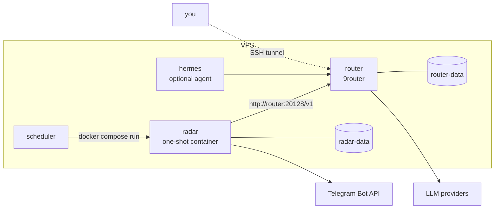

# Deploying on a VPS

This guide runs Job Radar on a Linux server so it keeps working while your computer is off.
It covers a plain Docker Compose deployment and the same stack managed by
[Dokploy](https://github.com/Dokploy/dokploy).

## Topology



| Service | Lifecycle | Notes |
| --- | --- | --- |
| `router` | long-running | LLM gateway; published on `127.0.0.1` only |
| `radar` | one-shot, scheduled | Runs the pipeline and exits; state in the `radar-data` volume |
| `hermes` | long-running, optional (`--profile agent`) | Telegram conversation agent |

No service needs to accept inbound connections from the internet.

## Prerequisites

- A Linux VPS. Router and radar are light; budget about 2 GB RAM if you also run Hermes
  (upstream suggests 2-4 GB for the agent).
- Docker Engine with the Compose plugin.
- A Telegram bot token and your numeric chat id ([local-setup.md](local-setup.md), step 4).
- At least one LLM provider API key.

## 1. Harden the host

1. Create a non-root user and disable password SSH login (keys only).
2. Enable a firewall that allows only SSH inbound.
3. Keep the system patched (for example `unattended-upgrades`).

> **Docker and firewalls.** Ports published by Docker bypass `ufw` rules. That is why the
> Compose file binds the gateway to `127.0.0.1` instead of relying on the firewall. Do not
> change it to `0.0.0.0` without authentication in front.

## 2. Deploy with Docker Compose

```bash
git clone <repository-url> /opt/job-radar
cd /opt/job-radar/deploy
cp .env.example .env
chmod 600 .env
```

Set `ROUTER_DASHBOARD_PASSWORD` in `deploy/.env` to a long random value
(`openssl rand -hex 24`). Compose refuses to start the router without it, because the dashboard
otherwise falls back to a default password.

### 2.1 Start the gateway

```bash
docker compose up -d router
```

### 2.2 Configure the gateway through an SSH tunnel

From your own computer:

```bash
ssh -L 20128:127.0.0.1:20128 <user>@<server>
```

Open <http://localhost:20128>, sign in with the dashboard password, then repeat
[local-setup.md](local-setup.md) steps 3.2-3.4: add providers, create the `job-scorer` combo
and create an API key. Close the tunnel when done.

Provider keys are stored in the `router-data` volume. Treat that volume, and any backup of it,
as secret.

### 2.3 Application settings

Put the remaining values in `deploy/.env`:

```dotenv
ROUTER_API_KEY=<key from the dashboard>
TELEGRAM_BOT_TOKEN=<token>
TELEGRAM_CHAT_ID=<id>
```

Place your profile on the host and point the stack at it:

```bash
install -m 600 profile.yaml /opt/job-radar/profile.yaml   # copied from your machine
echo 'RADAR_PROFILE_PATH=/opt/job-radar/profile.yaml' >> .env
```

Without `RADAR_PROFILE_PATH` the container uses the bundled example profile.

### 2.4 First run

```bash
docker compose run --rm radar run --dry-run     # builds the image, prints the digest, sends nothing
docker compose run --rm radar                   # runs and delivers via Telegram
```

The default container command is `run --send`. Use `--preview --min-score 30` to see lower
scoring jobs while tuning your profile.

## 3. Schedule it

The `radar` container is a one-shot job; something must start it.

### Option A: host cron

```cron
# 07:00 Asia/Jakarta (UTC+7) is 00:00 UTC. cron uses the server's timezone, usually UTC.
0 0 * * * cd /opt/job-radar/deploy && docker compose run --rm radar >> /var/log/job-radar.log 2>&1
```

### Option B: Dokploy schedules

Dokploy can run commands on a cron expression. See its documentation for how schedules target a
Compose service, and use the same command as above. Setup:

1. Install Dokploy on a fresh server by following its installation guide (the installer needs
   ports 80, 443 and 3000 free; read the script before piping it to a shell).
2. Create a **Compose** service from this Git repository with the compose file path
   `deploy/docker-compose.yml`.
3. Enter the contents of `deploy/.env` in the service's environment settings.
4. Do **not** attach a domain to the `router` service.
5. The Dokploy panel itself is initially served on port 3000. Put it behind a domain with
   HTTPS, or restrict it with the firewall.
6. Dokploy also publishes a ready-made template for the Hermes agent, if you prefer it over the
   `agent` profile in this repository.

### Option C: Hermes cron

If Hermes runs on the same host, its scheduler can run the pipeline. Because the Hermes
container does not contain this project's code, this option is simplest when Hermes runs on
the host rather than in Docker; see the Hermes section of [local-setup.md](local-setup.md).

## 4. Optional: the Hermes agent

```bash
docker compose run --rm hermes setup       # one-time wizard; writes to the hermes-data volume
docker compose --profile agent up -d hermes
```

In the wizard choose a custom OpenAI-compatible endpoint with base URL
`http://router:20128/v1` and your gateway API key, then configure the Telegram bot and the
allowed user ids. Rules from the Hermes documentation:

- Never run two gateway containers against the same data volume.
- Restrict the bot to your own Telegram user id; an open bot is a security risk.
- Only publish Hermes ports if you need its dashboard or API.

## 5. Operations

| Task | Command |
| --- | --- |
| Gateway logs | `docker compose logs -f router` |
| Run now | `docker compose run --rm radar` |
| Update the gateway | `docker compose pull router && docker compose up -d router` |
| Update the application | `git pull && docker compose build radar` |
| Inspect stored jobs | `docker compose run --rm --entrypoint python radar -c "import sqlite3;print(sqlite3.connect('/data/jobs.db').execute('select status,count(*) from jobs group by 1').fetchall())"` |

### Backups

The database is small and rebuildable (jobs are refetched), but `sent` markers prevent
duplicate messages. Back up the volume if that matters to you:

```bash
docker volume ls                            # note the exact volume name, e.g. deploy_radar-data
docker run --rm -v deploy_radar-data:/data -v "$PWD":/backup alpine \
  tar czf /backup/radar-data.tgz -C /data .
```

### Monitoring

A failed run exits non-zero but sends no message, because the digest channel is reserved for
results. Use your scheduler's failure notification, or a dead-man's-switch service that alerts
when the daily run does not check in.

### Pinning and rollback

Set `ROUTER_IMAGE_TAG` and `HERMES_IMAGE_TAG` in `deploy/.env` to specific versions instead of
`latest`. To roll back the application, check out the previous Git tag and rebuild the image.

## 6. Tear down

```bash
docker compose --profile agent --profile jobs down        # keep volumes
docker compose --profile agent --profile jobs down -v     # also delete all data
```

## Verification status

This guide is based on the upstream documentation of 9router, Hermes and Dokploy and on the
behavior of the application itself.

- The Compose file is validated with `docker compose config`, including the required-variable
  guard.
- The container image is built and smoke-tested in CI on every push.
- Image names, volume paths and environment variables for 9router and Hermes come from their
  upstream documentation; re-check them against the version you pin.
- The Dokploy and host-cron paths follow standard practice; confirm Dokploy's schedule syntax
  in its documentation for your version.
